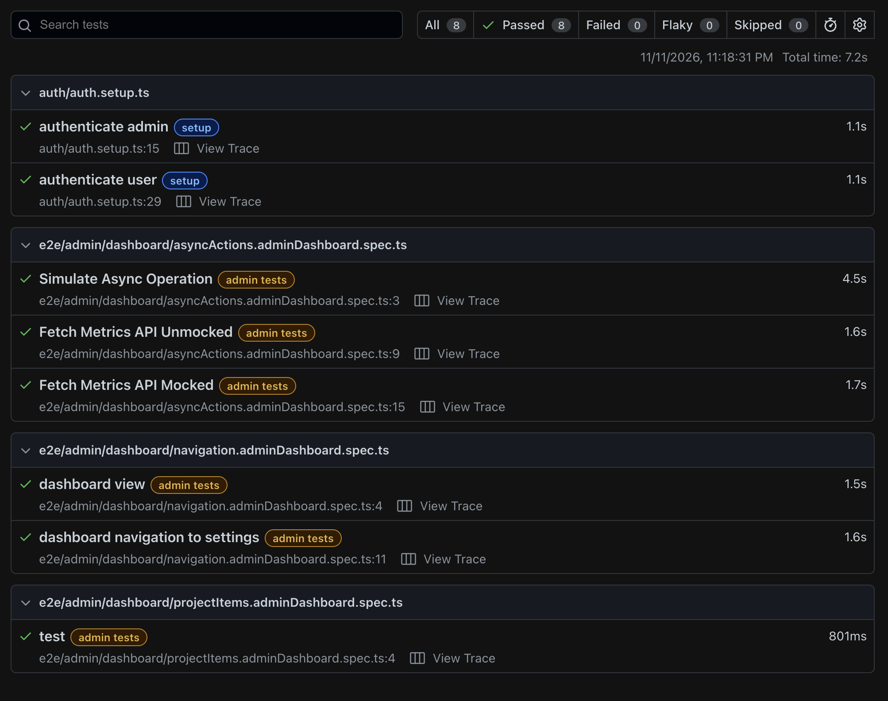

# Playwright Sample Project

This project contains Playwright end-to-end tests for an admin dashboard, using a page object model (POM) and custom fixtures to keep tests reusable and maintainable.

## Overview

The suite covers (ADMIN workflows):
- async operation flows
- mocked API responses
- dashboard UI assertions
- reusable browser/test fixtures

(TBD) user workflows

## Tech Stack

- Playwright
- TypeScript
- Page Object Model pattern
- Custom test fixtures

## Project Structure

```text
playwright_practice/
├── src/
│   ├── fixtures.ts
│   ├── page-objects/
│   │   ├── AsyncActionsDashboard.ts
│   │   └── base/
│   │       └── Dashboard.ts
├── tests/
│   └── e2e/
│       └── admin/
│           └── dashboard/
│               └── asyncActions.adminDashboard.spec.ts
├── package.json
├── playwright.config.ts
├── tsconfig.json
└── README.md
```

## Getting Started

Install dependencies:

```bash
npm install
```

Populate the `.env` file and run the following command to set environment variables:

```bash
(set -a; source .env; set +a)
```

Install Playwright browsers:

```bash
npx playwright install
```

Start the app on localhost:8080:

```bash
npm run start-app
```

## Run the tests

Run all tests:

```bash
npx playwright test
```

Run a specific spec:

```bash
npx playwright test tests/e2e/admin/dashboard/asyncActions.adminDashboard.spec.ts
```

Run in headed mode:

```bash
npx playwright test --headed
```

Run with UI mode:

```bash
npx playwright test --ui
```

Sample Test Run:
